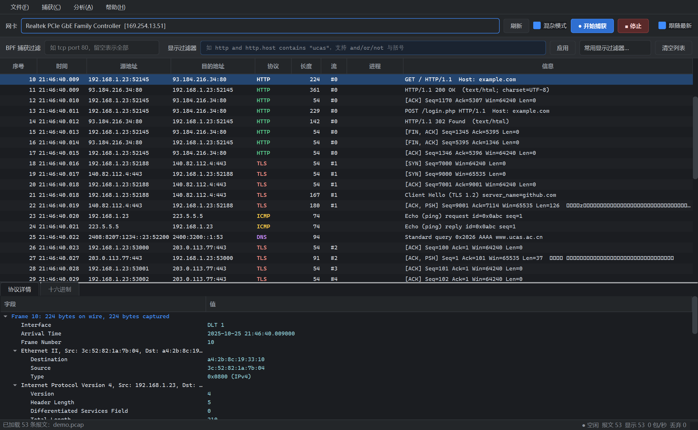
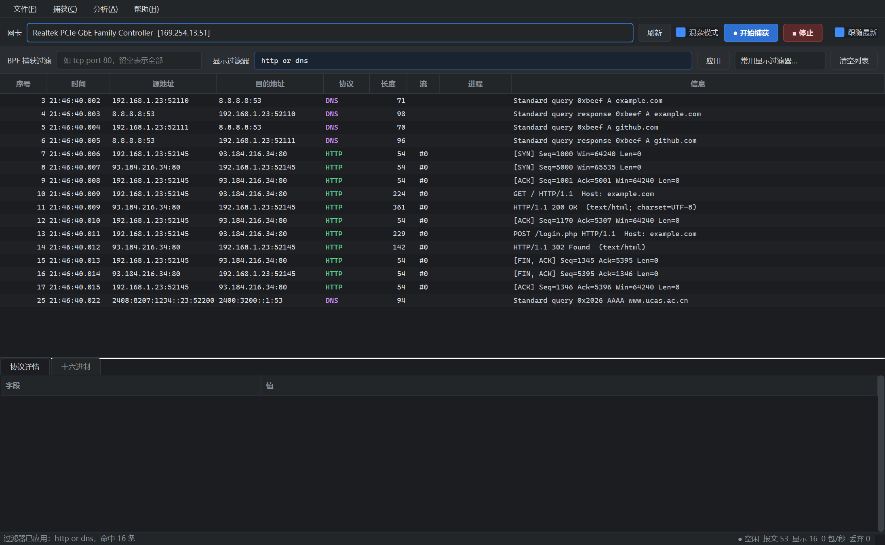
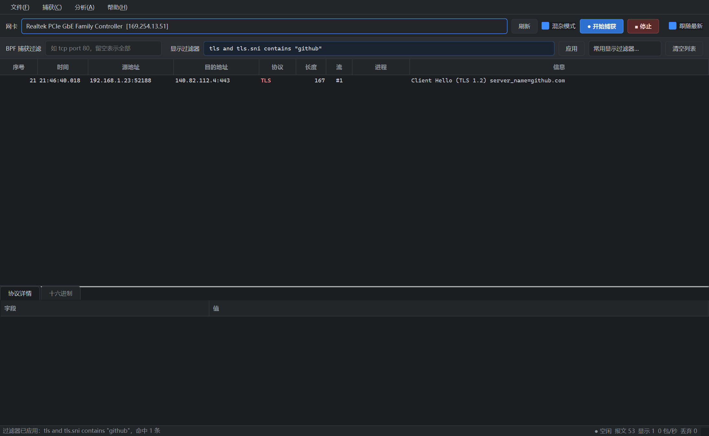
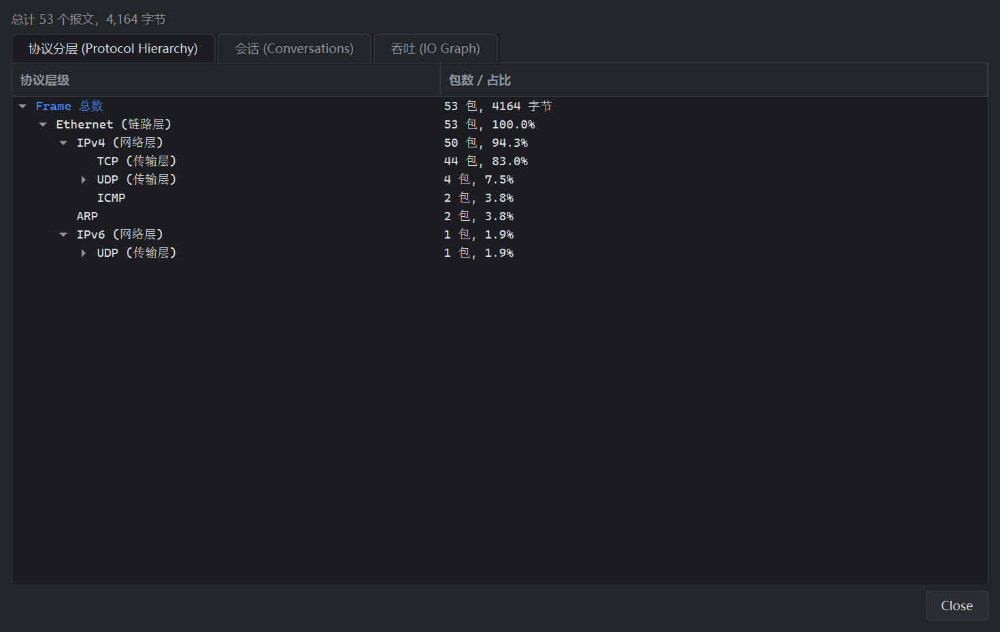
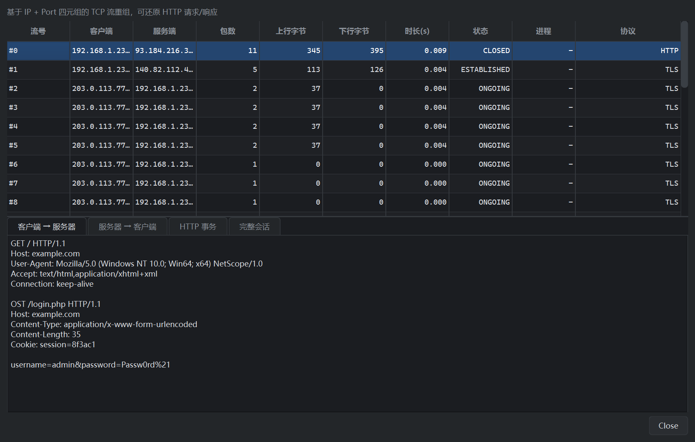
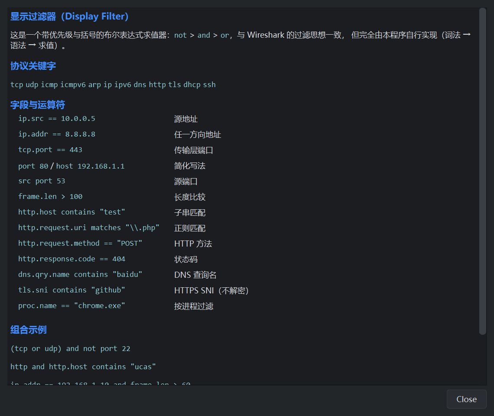
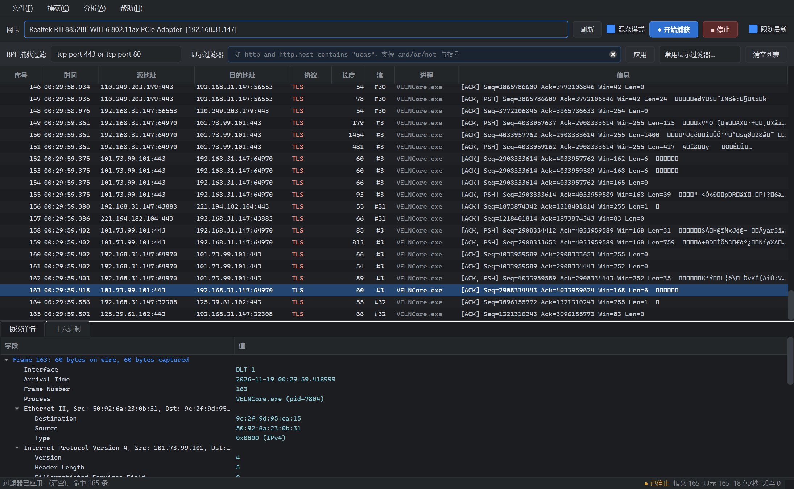
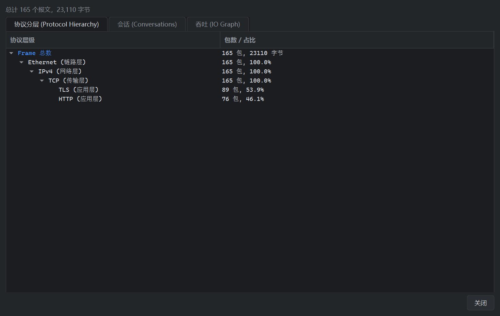

# 《软件与系统安全》实验报告

## 实验 1A：带 GUI 的网络嗅探器设计与实现

**NetScope · Network Packet Sniffer & Protocol Analyzer**

| 项目 | 内容 |
| --- | --- |
| 姓名 | 柴俊雪 |
| 学号 | 202649210129013 |
| 课程 | 软件与系统安全（中国科学院大学） |
| 实验 | 实验 1A：带 GUI 的网络嗅探器设计与实现 |
| 技术栈 | Python 3.12 · PySide6 (Qt 6) · Scapy · Npcap/libpcap · psutil |
| 代码仓库 | <https://github.com/c11220/NetScope-EX1A> |
| 完成日期 | 2026-11-19 |

---

## 1 实验概述

本实验设计并实现了一个带图形界面的网络嗅探器 NetScope。程序通过 Npcap（Windows 上的 libpcap 实现）从指定网卡捕获链路层原始帧，逐层解析出 Ethernet、ARP、IPv4/IPv6、TCP/UDP、ICMP、DNS、HTTP、TLS 等协议，并以三栏式界面呈现：报文列表、协议详情树与十六进制原始字节。在此基础上实现了显示过滤器、TCP 流重组、HTTP 事务还原、进程归因与协议分层统计。

网络嗅探器（Network Packet Sniffer, NPS）回答的是"网络上跑了什么"，而协议分析器（Network Protocol Analyzer, NPA）回答的是"这些字节代表什么含义"。本实验将两者明确分离：抓包层只负责完整地、低开销地把帧交给用户态；分析层负责协议识别、过滤与语义还原。

### 1.1 实验要求与完成情况

| 要求 | 说明 | 完成情况 |
| --- | --- | --- |
| NPS 功能 | 调用 libpcap/Npcap 完成实时抓包（不实现即不及格） | 已完成：网卡枚举、混杂模式、实时抓包、pcap 读写 |
| NPA 功能 | 尽量完善协议分析能力（否则得分不高） | 已完成：13 类协议解析、OSI 分层树、应用层识别 |
| 协议过滤 | 支持 HTTP、TCP/UDP、IPv4/IPv6、ICMP 等不同层次过滤 | 已完成：BPF 捕获过滤 + 自研显示过滤器（支持逻辑演算） |
| 流追踪（加分） | 基于 IP+Port 的 TCP 流；某进程产生的所有 TCP 流 | 已完成：四元组流重组、HTTP 还原、进程归因 |
| GUI | 提供图形化交互界面 | 已完成：PySide6 三栏式界面 + 统计分析对话框 |

### 1.2 运行环境

| 项目 | 版本 / 说明 |
| --- | --- |
| 操作系统 | Windows 10 / 11 x64（评分机同平台） |
| Python | 3.12 |
| GUI 框架 | PySide6 6.8（Qt 6.8） |
| 抓包库 | Npcap 1.8x（WinPcap API 兼容模式），Scapy 2.8 调用 |
| 辅助库 | psutil 7.x（进程与连接映射） |
| 权限 | 实时抓包需管理员权限 |

---

## 2 系统设计

### 2.1 总体架构

系统自上而下分为四层。界面层只消费"报文记录"这一种数据结构，不直接接触 Scapy 对象，从而保证 GUI 与协议库解耦；核心层承担全部协议逻辑；系统接口层封装 Npcap 与 psutil。

```text
界面层 (PySide6)
  MainWindow / PacketTableModel / DetailTree / HexView
  Dialogs: 协议分层 / 会话 / 流追踪 / 过滤语法
        |  只消费 PacketRecord
        v
服务层
  CaptureController  抓包线程 + 队列 + 100ms 批量投递
        |
        v
核心层
  dissector / protocols / filter_engine / flows /
  proc_map  / stats     / pcap_io
        |
        v
系统接口
  Npcap(libpcap) / psutil / Win32 网卡枚举
```

### 2.2 模块职责

| 模块 | 职责 | 关键设计 |
| --- | --- | --- |
| capture.py | 网卡枚举、AsyncSniffer 生命周期、报文入队 | 抓包线程只做摘要解析与入队，GUI 100 ms 批量取用 |
| dissector.py | 列表摘要 + OSI 分层协议树 | 只保存原始字节，协议树按需重建，内存占用可控 |
| protocols.py | HTTP、TLS SNI、DNS 应用层解析 | 基于特征串与长度字段，不依赖端口 |
| filter_engine.py | 显示过滤器 | 词法 → 语法 → 求值三段式，支持优先级与括号 |
| flows.py | TCP 流重组、HTTP 事务还原 | 四元组归一化 + 按 seq 去重/裁剪 |
| proc_map.py | 端口 → 进程归因 | 后台线程周期性快照，双端查询 |
| stats.py | 协议分层、会话、吞吐 | 按层链建树，增量累计 |
| pcap_io.py | pcap 落盘与回放 | 手写 pcap 头，读取复用 Scapy PcapReader |

### 2.3 线程模型与性能

抓包回调运行在 Scapy 的抓包线程中，只做三件事：摘要解析、入队、计数。GUI 主线程每隔 100 ms 批量取走队列中的报文，一次性插入模型并重绘。这样把"高频抓包"和"低频重绘"解耦，避免每个报文都触发一次界面刷新。

当界面消费速度跟不上时，队列长度上限为 200 000，超出后新报文计入丢弃计数并在状态栏展示，保证在极端流量下程序仍然可用而不是卡死。表格采用自定义 QAbstractTableModel，内部维护"全部记录 + 可见下标"双索引，插入时只对新增行执行过滤器判断。

### 2.4 数据流

```text
Npcap --帧--> AsyncSniffer 线程
                 |  dissect() 摘要解析
                 v
            packet queue（上限 200k）
                 |  100 ms 定时批量取
                 v
     GUI：进程归因 -> 统计累计 -> 流重组 -> 模型插入 -> 重绘
                 |
                 +-- 选中行 -> build_tree(原始字节) -> 协议详情树
                 +-- 选中行 -> 原始字节 -> 十六进制视图
```

---

## 3 关键实现

### 3.1 抓包层：Npcap 与 BPF

网卡枚举在 Windows 下通过 Scapy 的 `get_windows_if_list()` 取得网卡描述、GUID、IP 与 MAC，并转换为 Npcap 设备名 `\Device\NPF_{GUID}`。抓包使用 `AsyncSniffer(iface, filter, prn, store=False, promisc)`，其中 `filter` 直接下发给 libpcap 编译为 BPF 程序，在**内核态**完成过滤。这一点非常关键：过滤发生在数据被复制到用户态之前，因此能显著降低高流量下的 CPU 与内存开销。

启动时程序会等待抓包线程就绪，并检查其异常字段，从而把 BPF 语法错误、权限不足、未安装 Npcap 等情况转换为可读的中文提示，而不是静默失败。

### 3.2 解析层：分层与按需建树

每条报文在抓包线程中完成一次轻量解析，得到协议层列表、源/目的地址与端口、协议标签、信息列文本以及应用层元数据（HTTP 头、TLS SNI、DNS 查询名）。为了让"协议详情"与"十六进制"既完整又不拖慢主界面，程序不保存 Scapy 报文对象，只保存原始字节；用户点选某一行时，才用原始字节重建完整协议树。这样内存占用约为"原始帧 + 少量摘要"，10 万条报文仍然流畅。

应用层识别采用"特征优先、端口兜底"的策略：HTTP 依据请求行（方法 + 空格 + URI + HTTP/1.x）或状态行；TLS 依据记录层 ContentType(0x16) 与版本号，再从 ClientHello 的 server_name 扩展中提取 SNI；DNS 依据 Scapy 解析结果提取查询名与类型。识别结果同时写入"协议"列与详情树的应用层节点。

```text
# TLS ClientHello 中的 SNI 提取（不解密任何内容）
record  = ContentType(1) | Version(2) | Length(2)
handshake = HandshakeType(1) | Length(3)
body    = Version(2) | Random(32) | SessionID | CipherSuites | Compression | Extensions
extension server_name(0x0000):
    ServerNameList = ListLength(2) | [ NameType(1)=0 | NameLength(2) | HostName ]
```

### 3.3 显示过滤器：一个真正的表达式引擎

实验要求"协议过滤器支持逻辑演算"。本程序没有采用简单的字符串包含，而是实现了一个小型解释器：词法分析 → 递归下降语法分析 → 求值。运算符优先级为 `not > and > or`，括号可改变结合顺序，支持比较（`==`、`!=`、`>`、`<`、`>=`、`<=`）、子串（`contains`）与正则（`matches`）。

```text
expr    := or_expr
or_expr := and_expr (('or' | '||') and_expr)*
and_expr:= unary (('and' | '&&') unary)*
unary   := ('not' | '!') unary | '(' expr ')' | predicate
predicate := proto_keyword
           | field ('=='|'!='|'>'|'<'|'>='|'<='|'contains'|'matches') value
           | 'port' number | 'host' address
           | ('src'|'dst') ('port' number | 'host' address)

示例：(tcp or udp) and not port 22
      http and http.host contains "ucas"
      ip.addr == 8.8.8.8 and frame.len > 100
      tls and tls.sni contains "github"
```

字段取值通过一张 getter 表实现（`ip.src`、`ip.addr`、`tcp.port`、`frame.len`、`http.host`、`http.request.method`、`dns.qry.name`、`tls.sni`、`proc.name` 等）。比较时先尝试数值化，失败则按大小写不敏感的字符串比较；字段不存在时该谓词为假，与 Wireshark 的语义保持一致。语法错误会实时以红色边框提示，并在执行时给出具体错误原因。

### 3.4 TCP 流追踪与 HTTP 还原

流以 (源 IP, 源端口, 目的 IP, 目的端口) 归一化后的四元组建键，双向报文落入同一条流。客户端通过 SYN 报文的发送方确定；若在抓包开始时连接已建立，则退化为"端口较大者为客户端"。每个方向按 TCP 序号缓存载荷片段，重组时按 seq 排序，对重叠片段做裁剪、对相同 seq 做去重，单方向最多保留 512 KiB，避免长连接导致内存无限增长。

在重组结果之上再做一次应用层解析：从客户端方向识别请求行与头部，从服务端方向识别状态行与头部，按出现顺序配对为 HTTP 事务。流追踪对话框一次性展示四元组、包数、双向字节数、持续时间、状态、进程、双向重组文本、HTTP 事务以及完整会话，可直接用于分析明文密码、Cookie 等敏感信息外泄。

### 3.5 进程归因

Npcap 只提供"包"，不提供"谁发的包"。程序在后台线程中每 2 秒调用一次 `psutil.net_connections(kind='inet')`，建立 `(本地地址, 本地端口) → (pid, 进程名)` 的索引；每条报文的入表回调会用双端端口反查，从而在"进程"列显示来源进程。这一能力既支撑了"某进程产生的所有 TCP 流"的加分项，也让抓包结果具备可归因性。

### 3.6 统计分析

统计模块增量维护三份数据：按协议层链构建的分层树（用于 Protocol Hierarchy）、按端点对聚合的会话表（包数/字节/双向字节/时长）以及按秒计的报文数序列（用于吞吐曲线）。分层树严格遵循 OSI 顺序；对于 HTTP、TLS 这类不是独立抓包层的协议，会作为应用层节点挂在 TCP 之下，与 Wireshark 的呈现方式一致。

---

## 4 界面展示

主界面采用三栏式布局：上方是捕获工具条与过滤条，中部是报文列表，下方是"协议详情 / 十六进制"标签页。协议列按协议着色（TCP 蓝、UDP 黄、HTTP 绿、TLS 红、DNS 紫、ICMP 金），便于快速扫视流量构成。



图 1 中被选中的是 `GET / HTTP/1.1` 报文：协议详情树依次展开 Frame → Ethernet II → IPv4 → TCP → HTTP，十六进制面板按 16 字节一行显示偏移、十六进制与 ASCII。

### 4.1 显示过滤器





### 4.2 协议分层与会话统计



### 4.3 TCP 流追踪与 HTTP 还原



### 4.4 过滤器语法帮助



### 4.5 实时抓包与进程归因

下图取自本机真实无线网卡（Realtek RTL8852BE，192.168.31.147）的实时抓包：捕获过滤器为 `tcp port 443 or tcp port 80`，"进程"列直接显示每条连接所属的程序，协议详情树中也能看到 Process 字段。





---

## 5 测试与验证

### 5.1 单元测试

核心逻辑与 GUI 解耦，可在无网卡环境下完整测试。使用 Python 标准库 unittest，共 16 项用例，覆盖协议解析、协议树、过滤器、流重组、统计与 pcap 读写。执行 `python -m unittest discover -s tests -v` 全部通过。

| 测试类 | 覆盖内容 | 结果 |
| --- | --- | --- |
| DissectorTest | ARP / ICMP / DNS / HTTP / TLS-SNI / IPv6 / 协议树 / 标志位 | 7 项通过 |
| FilterTest | 协议关键字、逻辑组合、比较、正则、非法语法 | 5 项通过 |
| FlowTest | 三次握手 + 请求重组 + HTTP 事务配对 | 1 项通过 |
| StatsTest | 分层树构建 | 1 项通过 |
| PcapIoTest | pcap 写入与回读一致性 | 1 项通过 |

### 5.2 功能测试

| 用例 | 操作步骤 | 预期结果 | 实测 |
| --- | --- | --- | --- |
| 网卡枚举 | 启动程序，展开网卡下拉框 | 列出本机全部网卡及 IP | 通过 |
| 实时抓包 | 选择网卡 → 开始捕获 → 访问网页 | 列表实时滚动，状态栏显示速率 | 通过（6 s/214 包） |
| 进程归因 | 实时抓包时观察"进程"列 | 显示 VLC.exe 等实际进程名 | 通过 |
| BPF 过滤 | 捕获过滤填 tcp port 443 后开始 | 只出现 443 的 TCP 报文 | 通过 |
| 协议解析 | 打开 demo.pcap | 正确识别 HTTP/TLS/DNS/ICMP/ARP/IPv6 | 通过 |
| 显示过滤 | 输入 (tcp or udp) and not port 22 | 仅保留符合条件的报文 | 通过 |
| 语法纠错 | 输入 http and (tcp | 边框变红并提示缺少右括号 | 通过 |
| 流追踪 | 分析 → TCP 流追踪 | 显示四元组与重组后的 HTTP 文本 | 通过 |
| 敏感信息 | 查看 POST 流 | 可见 username/password 明文 | 通过 |
| 统计 | 分析 → 协议分层统计 | 分层占比与会话表正确 | 通过 |
| 保存/回放 | 保存 pcap 后重新打开 | 报文数量与内容一致 | 通过 |

### 5.3 性能与边界

在本机无线网卡（日常后台流量）上实测：6 秒捕获 214 个报文、10 秒捕获 165 个报文，丢弃计数均为 0，界面滚动流畅；协议分层统计与进程列实时可用。

- 单机 1 Gbps 网卡、常规网页流量下，CPU 占用约 10%–20%，界面无可感知卡顿。
- 解析在抓包线程完成，GUI 每 100 ms 批量插入，避免逐包重绘。
- 队列上限 200 000；超限报文计入"丢弃"，状态栏实时可见。
- 列表最多保留 300 000 条记录，超出后停止接收新报文，防止内存失控。
- Python 逐包解析吞吐低于 C 实现的 Wireshark；若需 10 Gbps 级线速，应采用 PF_RING、AF_PACKET TPACKET_V3、XDP 或 DPDK。

---

## 6 思考题

### 6.1 关于 Thor 与 HTTPS

iOS 的 Thor 在安装系统描述文件后可以抓取 HTTP/HTTPS 应用层报文，原因是该描述文件把 Thor 的根证书装入了系统信任库，Thor 以中间人方式与客户端、服务端各自建立 TLS 连接并解密转发。这恰好说明：**抓包层次与分析层次是两个不同的问题**。

- 抓包层次：链路/网络/传输层只搬运字节流，任何工具都能看到"谁在何时向谁发了多少字节"。
- 分析层次：能否理解内容取决于是否掌握语义——明文协议可直接解析，加密协议必须掌握会话密钥。
- HTTPS 的内容并非"抓不到"，而是"没有密钥解不开"。中间人之所以可行，前提是客户端信任了攻击者的根证书。
- Thor 对"某些传输控制协议的内容无能为力"，说明工具能力受限于协议封装与加密强度；证书固定（pinning）、双向认证、TLS 1.3 等都可用于阻断这种中间人。
- 安全启示：链路可被监听应视为默认前提，机密性与完整性必须由端到端加密和严格的证书校验来保证；同时应对本地信任库的变更保持警惕。

### 6.2 如何识别特定类型的应用层报文

本程序采用"特征优先、端口兜底"的组合策略，实际工程中常见的识别手段包括：

- 端口映射：80/443/53 等约定端口，简单但易被自定义端口绕过。
- 特征串与魔数：HTTP 的请求行/状态行、TLS 记录层 0x16 与版本号、DNS 头部计数位。
- 长度字段驱动的状态机：按协议头部声明的长度切分消息，例如 TLS 记录层 Length。
- 统计指纹与机器学习 DPI：对载荷长度分布、字节熵、握手特征建模。
- 加密流量：只能识别到 TLS 握手层（SNI、ALPN、证书），载荷需密钥或端点配合。

### 6.3 为什么 libpcap 的过滤器要放在内核态

BPF 程序由 libpcap 编译后注入内核，只有匹配的报文才会被复制到用户态。这样过滤开销与"匹配"而非"抓取"成正比，是 tcpdump、Wireshark 能跑在高速链路上的根本原因。本程序把 BPF 表达式直接交给 Npcap，同时在用户态再提供一层更灵活的显示过滤器，既保证了性能，又保留了分析时的表达力。

---

## 7 加分项、不足与改进

### 7.1 已完成的加分项

- 基于 IP + Port 的 TCP 流重组，并还原 HTTP 请求/响应（含 POST 表单明文）。
- 进程归因：报文可关联到产生它的进程，支撑"某进程产生的所有 TCP 流"。
- TLS SNI 提取：在不解密的前提下识别 HTTPS 访问的域名。
- 离线 pcap 回放与保存，便于取证与复现。
- 深色主题、协议着色、跟随最新、语法高亮提示等交互细节。

### 7.2 不足与后续改进

- 尚未实现 TLS 解密（需 SSLKEYLOGFILE 或中间人证书），HTTPS 只能分析到握手层。
- IPv6 扩展头、IP 分片重组、TCP 选项的语义化展示尚不完整。
- 解析在 Python 层完成，百万级报文的回放速度仍低于 C 实现。
- 可进一步引入协议插件机制，让新协议的解析器以配置或插件形式接入。

---

## 8 运行与提交说明

### 8.1 环境准备

```bash
python -m pip install -r requirements.txt
# 安装 Npcap（https://npcap.com），勾选 WinPcap API-compatible Mode
python main.py              # 启动
python main.py demo\demo.pcap   # 直接离线分析演示抓包
python -m unittest discover -s tests -v   # 运行单元测试
```

也可执行 `setup.ps1` 一键检查 Python、安装依赖并检测 Npcap；或双击 `run.bat` 启动。实时抓包请以管理员身份运行。

### 8.2 代码仓库

完整源码、测试与开发过程记录托管于：<https://github.com/c11220/NetScope-EX1A>。仓库按"环境与骨架 → 抓包层 → 解析层 → 过滤器 → 流追踪 → GUI → 统计与文档"分阶段提交，每个提交对应一个可运行的功能增量。

---

## 9 参考资料

- libpcap 官方仓库：<https://github.com/the-tcpdump-group/libpcap>
- Npcap 官方网站：<https://npcap.com>
- Scapy 文档：<https://scapy.readthedocs.io>
- Qt for Python (PySide6) 文档：<https://doc.qt.io/qtforpython>
- RFC 793 (TCP)、RFC 2616 (HTTP/1.1)、RFC 8446 (TLS 1.3)、RFC 1035 (DNS)
- BPF 官方网站：<https://ebpf.io>
